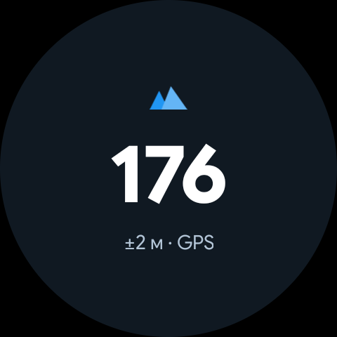
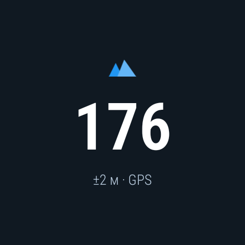

# 2DO: screenshots & apks

# Барометр для Wear OS

Минималистичное приложение для Wear OS, отображающее высоту над уровнем моря на основе барометрического давления.

 

## ✨ Возможности

- 📊 **Точное измерение высоты** - использует встроенный барометр для расчета высоты по стандартной атмосферной формуле
- 🔄 **Непрерывное обновление** - данные обновляются каждые 5 секунд при открытом тайле
- 💾 **Кэширование данных** - последние показания сохраняются и отображаются даже после перезапуска
- 🎯 **Wear OS Tile** - быстрый доступ к высоте прямо с циферблата
- 🎨 **Минималистичный дизайн** - чистый интерфейс с иконкой гор и крупными цифрами
- ⚡ **Низкое энергопотребление** - датчик активируется только при просмотре

## 📋 Требования

- **Wear OS 3.0+** (API 30+)
- Датчик барометрического давления
- Разрешение на точную геолокацию (для калибровки)

## 🔧 Технические детали

### Принцип работы
Приложение использует барометрический датчик давления для определения высоты. Расчет производится по стандартной атмосферной формуле:

```
h = 44330 * (1 - (P/P0)^0.1903)
```

где:
- `h` - высота в метрах
- `P` - текущее давление в гПа
- `P0` - давление на уровне моря (1013.25 гПа)

### Архитектура

- **AltitudeTileService** - сервис Wear OS Tile с управлением датчиком давления
- **MainActivity** - основной экран приложения с реалтайм обновлениями
- **SharedPreferences** - кэширование последних показаний для быстрого запуска
- **SensorEventListener** - обработка данных барометра с частотой SENSOR_DELAY_UI

## 🚀 Установка

### Из исходного кода

1. Клонируйте репозиторий:
```bash
git clone https://github.com/yourusername/wear-barometer.git
cd wear-barometer
```

2. Подключите Wear OS устройство или запустите эмулятор

3. Соберите и установите:
```bash
./gradlew installDebug
```

### Через ADB

```bash
adb install -r app/build/outputs/apk/debug/app-debug.apk
```

## 📱 Использование

### Первый запуск
1. Откройте приложение "Барометр" на часах
2. Предоставьте разрешение на доступ к точной геолокации
3. Приложение начнет показывать текущую высоту

### Добавление Tile
1. На циферблате свайпните влево/вправо для просмотра тайлов
2. Скролльте до конца и нажмите "+" (Добавить плитку)
3. Выберите "Барометр" из списка доступных тайлов
4. Тайл появится в карусели и будет обновляться каждые 5 секунд

## 📁 Структура проекта

```
wear-barometer/
├── app/
│   ├── src/main/
│   │   ├── java/com/example/wearbarometer/
│   │   │   ├── AltitudeTileService.kt    # Tile сервис с барометром
│   │   │   └── MainActivity.kt           # Основной экран приложения
│   │   ├── res/
│   │   │   ├── drawable/
│   │   │   │   └── ic_mountain.xml       # Иконка гор
│   │   │   ├── layout/
│   │   │   │   └── activity_main.xml     # Layout главного экрана
│   │   │   └── values/
│   │   │       └── strings.xml
│   │   └── AndroidManifest.xml
│   └── build.gradle.kts
├── build.gradle.kts
├── settings.gradle.kts
├── .gitignore
└── README.md
```

## 🛠️ Зависимости

```kotlin
// Wear OS
implementation("androidx.wear.tiles:tiles:1.5.0")
implementation("androidx.wear.protolayout:protolayout:1.3.0")
implementation("androidx.wear.protolayout:protolayout-material:1.3.0")

// Google Play Services
implementation("com.google.android.gms:play-services-location:21.3.0")

// Async
implementation("com.google.guava:guava:33.3.1-android")
```

## ⚙️ Настройка

### Изменение интервала обновления
В `AltitudeTileService.kt`, метод `buildTile()`:
```kotlin
.setFreshnessIntervalMillis(5_000) // 5 секунд (5000ms)
```

### Изменение времени кэша
В `AltitudeTileService.kt`, метод `getPressureAltitude()`:
```kotlin
if (age > 300_000) { // 5 минут
```

## 🤝 Вклад в проект

Баг-репорты и пул-реквесты приветствуются! Для серьезных изменений сначала откройте issue для обсуждения.

## 📄 Лицензия

MIT License - см. [LICENSE](LICENSE) для деталей

## 👨‍💻 Автор

Создано с помощью Claude Code

## 🙏 Благодарности

- Material Design Icons для иконки гор
- Wear OS Tiles API документация
- Сообщество Android разработчиков
